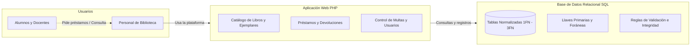

# Entregable 1: Planteamiento del Problema

> **Materia:** Modelos de Bases de Datos  
> **Proyecto:** Sistema de Gestión Bibliotecaria  
> **Entregable:** 1 — Planteamiento del Problema  
> **Fecha:** Noviembre 2026  

---

## Índice

1. [Introducción y Contexto](#1-introducción-y-contexto)
2. [Antecedentes y Justificación](#2-antecedentes-y-justificación)
3. [Descripción del Problema Actual](#3-descripción-del-problema-actual)
   - [3.1 Control de Libros e Inventario](#31-control-de-libros-e-inventario)
   - [3.2 Proceso de Préstamos y Devoluciones](#32-proceso-de-préstamos-y-devoluciones)
   - [3.3 Cobro de Multas y Sanciones](#33-cobro-de-multas-y-sanciones)
   - [3.4 Falta de Reportes y Estadísticas](#34-falta-de-reportes-y-estadísticas)
   - [3.5 Resumen de Problemas e Impacto](#35-resumen-de-problemas-e-impacto)
4. [Propuesta de Solución](#4-propuesta-de-solución)
   - [4.1 Diseño de una Base de Datos Relacional](#41-diseño-de-una-base-de-datos-relacional)
   - [4.2 Aplicación Web para Administración](#42-aplicación-web-para-administración)
5. [Objetivos del Proyecto](#5-objetivos-del-proyecto)
   - [5.1 Objetivo General](#51-objetivo-general)
   - [5.2 Objetivos Específicos](#52-objetivos-específicos)
6. [Alcance del Proyecto](#6-alcance-del-proyecto)

---

## 1. Introducción y Contexto

En el entorno universitario, la biblioteca es un espacio fundamental para el aprendizaje y la investigación. Día con día atiende a una comunidad activa de estudiantes y profesores que necesitan consultar o llevarse material bibliográfico en préstamo.

Para que el servicio funcione de forma ordenada, la biblioteca necesita coordinar tres cosas clave:
1. **Los libros disponibles:** saber qué títulos existen y cuántas copias físicas hay en los estantes.
2. **Los usuarios:** tener identificados a los alumnos y docentes mediante su matrícula o número de empleado.
3. **Los préstamos y devoluciones:** registrar quién tiene cada libro, en qué fecha debe entregarlo y si existen sanciones en caso de entregas fuera de tiempo.

Este documento expone las fallas que ocurren cuando esta información se administra de forma manual o desorganizada, y plantea la solución mediante una base de datos relacional y una aplicación web básica.

---

## 2. Antecedentes y Justificación

Durante mucho tiempo, e incluso en la actualidad en algunas instituciones, el control de la biblioteca se ha llevado en libretas de papel, carpetas de registro o archivos de Excel compartidos. 

Aunque estos métodos pueden funcionar cuando hay pocos libros y pocos usuarios, generan serios problemas a medida que la biblioteca crece:

- **Información desactualizada o duplicada:** Si varios bibliotecarios atienden al mismo tiempo, los datos de un archivo pueden sobrescribirse o no coincidir con lo que está anotado en papel.
- **Datos repetidos innecesariamente:** En cada préstamo se vuelve a escribir el nombre del alumno, su carrera, teléfono o correo, lo que genera errores tipográficos y dificulta contactarlo si debe un libro.
- **Pérdida de libros:** Cuando no existe un registro exacto de qué copia física se le prestó a cada usuario, los libros extraviados o no devueltos se vuelven muy difíciles de rastrear, lo que representa una pérdida económica para la escuela.

Por ello, desarrollar una base de datos relacional bien estructurada y normalizada es la mejor opción. Esto garantiza que la información no esté duplicada, que las relaciones entre usuarios, libros y préstamos sean siempre válidas (evitando registros incompletos o huérfanos) y que los datos se mantengan consistentes en todo momento.

---

## 3. Descripción del Problema Actual

Al analizar cómo opera actualmente una biblioteca con procesos manuales, encontramos los siguientes problemas principales:

### 3.1 Control de Libros e Inventario
- **Confusión entre el título y las copias físicas:** En muchos registros no se separa el concepto de la obra (título, autor, editorial, ISBN) de los ejemplares físicos reales que existen en la biblioteca. Esto provoca que no se sepa con certeza cuántas copias están disponibles para préstamo y cuántas están en uso o dañadas.
- **Títulos duplicados con nombres distintos:** Si un libro se registra como *"Cálculo Diferencial"* y en otra ocasión como *"Cálculo diferencial - 2da Ed."*, el sistema o la libreta los toma como dos libros diferentes, desordenando el catálogo.
- **Falta de ubicación clara:** No se tiene registrado con precisión en qué estante o pasillo se encuentra un ejemplar, lo que hace perder tiempo a los bibliotecarios al buscarlo.

### 3.2 Proceso de Préstamos y Devoluciones
- **Atención lenta en mostrador:** El personal tiene que revisar hojas o buscar renglón por renglón si el alumno tiene libros pendientes antes de prestarle uno nuevo, lo que causa filas y demoras entre clases.
- **No se respetan las reglas de préstamo:** No hay una forma automática de validar los límites (por ejemplo, permitir máximo 3 libros por 7 días a un alumno, o 5 libros por 14 días a un profesor). Como resultado, a veces se prestan más libros de lo permitido.
- **Falta de historial:** Al devolver un libro, muchas veces sólo se tacha o se borra la fila de la libreta, perdiéndose el historial de qué libros fueron los más leídos o el comportamiento de entrega de los usuarios.

### 3.3 Cobro de Multas y Sanciones
- **Cálculo manual de días de retraso:** Al recibir un libro devuelto con retraso, el bibliotecario calcula los días y el monto de la multa a mano o con calculadora. Esto se presta a errores de cobro o confusiones con los usuarios.
- **Alumnos morosos que siguen pidiendo libros:** Debido a que el turno de la tarde no siempre sabe lo que ocurrió en el de la mañana, un usuario con multas pendientes o libros sin entregar puede solicitar préstamos nuevos sin ser detectado.

### 3.4 Falta de Reportes y Estadísticas
- Resulta muy difícil y tardado obtener información para la toma de decisiones, por ejemplo:
  - ¿Cuáles son los libros más pedidos por carrera?
  - ¿Qué títulos tienen meses sin que nadie los consulte?
  - ¿Cuánto dinero se ha recaudado o está pendiente de cobro por concepto de multas?
  - ¿Quiénes son los usuarios con mayor índice de morosidad?

### 3.5 Resumen de Problemas e Impacto

| Área | Causa Principal | Impacto Real en la Biblioteca |
|---|---|---|
| **Catálogo** | Mezclar los datos del libro con sus copias físicas. | Inventario desfasado, libros extraviados sin responsable y compras duplicadas. |
| **Préstamos** | Registro manual o en hojas de cálculo simples. | Tiempos de espera largos en mostrador y violación a las políticas de préstamo. |
| **Multas** | Cálculo a mano de las fechas de mora. | Cobros desiguales o erróneos, y alumnos con deudas que siguen sacando libros. |
| **Usuarios** | Datos de contacto escritos una y otra vez en cada préstamo. | Teléfonos o correos desactualizados, complicando avisarles sobre entregas pendientes. |
| **Dirección** | Ausencia de una base de datos central. | Falta de estadísticas claras para saber qué libros nuevos comprar o dar de baja. |

---

## 4. Propuesta de Solución

Para resolver estos problemas de fondo, se propone crear un **Sistema de Gestión Bibliotecaria** compuesto por dos partes principales: una base de datos relacional sólida y una aplicación web sencilla para el personal de la biblioteca.

### 4.1 Diseño de una Base de Datos Relacional
La parte central del proyecto es la base de datos, cuidando especialmente:
- **Separar títulos de ejemplares:** Una tabla para los datos generales del libro (`Libro`) y otra para cada copia física individual (`Ejemplar`), con su propio código y estado (disponible, prestado, en reparación).
- **Normalización (de 1FN a 3FN):** Aplicar las tres formas normales para eliminar datos repetidos y evitar que dependan de campos incorrectos.
- **Relaciones e integridad:** Utilizar llaves primarias (`PRIMARY KEY`) y foráneas (`FOREIGN KEY`) para que no existan préstamos sin usuario o devoluciones sin libro registrado.
- **Restricciones automáticas:** Configurar reglas en la base de datos para asegurar que los campos no queden vacíos donde sean obligatorios y que datos como la matrícula sean únicos.

### 4.2 Aplicación Web para Administración
Para que el personal de la biblioteca pueda usar la base de datos sin complicaciones técnicas, se desarrollará un sistema web práctico:
- **Backend en PHP:** Encargado de recibir las acciones del usuario, procesar las fechas de préstamo, calcular las multas y comunicarse de forma segura con la base de datos.
- **Frontend sencillo (HTML, CSS y JavaScript):** Pantallas claras y funcionales para registrar libros, buscar usuarios, prestar ejemplares con un par de clics y marcar devoluciones.

---

## 5. Objetivos del Proyecto

### 5.1 Objetivo General

> Desarrollar un sistema de gestión bibliotecaria mediante una base de datos relacional normalizada y una aplicación web en PHP, que permita administrar de forma centralizada el catálogo de libros, el padrón de usuarios, los préstamos, devoluciones y el cobro de multas en una biblioteca universitaria.

### 5.2 Objetivos Específicos

1. **Diseñar el modelo de datos (DER):** Elaborar el Diagrama Entidad-Relación que identifique claramente las entidades del sistema (usuarios, libros, ejemplares, préstamos y multas), sus atributos y cómo se relacionan entre sí.
2. **Aplicar las reglas de normalización (1FN a 3FN):** Descomponer las tablas paso a paso para eliminar redundancias y evitar problemas al insertar, modificar o eliminar registros.
3. **Crear la base de datos física y su diccionario:** Escribir el script SQL con los tipos de datos adecuados, llaves primarias, llaves foráneas y reglas de validación, documentando cada campo en un diccionario de datos.
4. **Construir los módulos principales de la aplicación web:** Desarrollar en PHP las pantallas y funciones básicas para dar de alta libros y usuarios, registrar préstamos con fecha de vencimiento y bloquear automáticamente a usuarios con moras pendientes.
5. **Realizar pruebas de funcionamiento:** Comprobar mediante casos de prueba prácticos que el sistema respete las reglas de negocio (como el límite de libros o el cálculo exacto de días de multa) y funcione de manera consistente.

---

## 6. Alcance del Proyecto

Para mantener el proyecto viable para la entrega, se delimita lo siguiente:

- **Lo que sí incluye el sistema:**
  - Alta, baja y consulta de libros y ejemplares físicos.
  - Registro de usuarios clasificados en Alumnos y Docentes con su respectiva matrícula o número de empleado.
  - Control de préstamos con fecha programada de entrega.
  - Registro de devoluciones con cálculo automático de días de retraso y monto de la multa.
  - Estatus del usuario para evitar que una persona con adeudos solicite más libros.

- **Lo que queda fuera de esta versión (no incluido):**
  - Pasarelas de pago electrónico con tarjeta o servicios externos para pagar multas.
  - Sistema de apartado o reserva de libros por internet para los alumnos.
  - Lectores de etiquetas RFID (el sistema trabajará con códigos de barras o identificadores manuales).
  - Préstamos interbibliotecarios con otras escuelas o campus.
