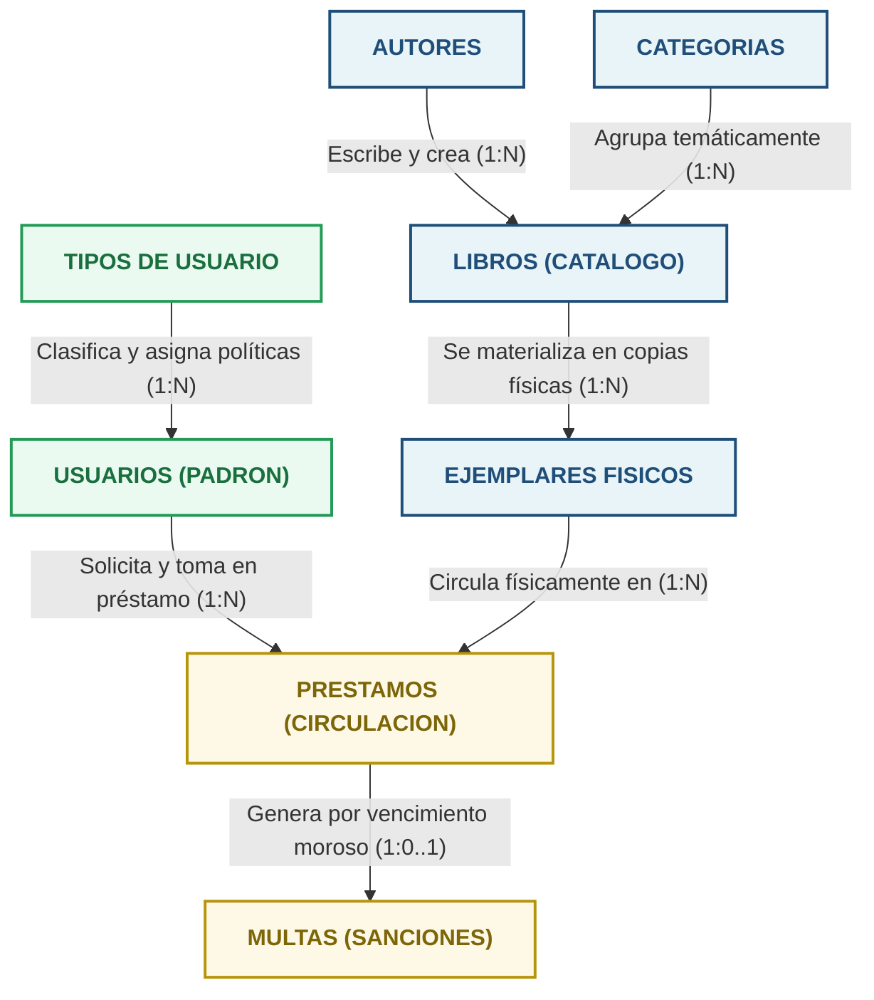
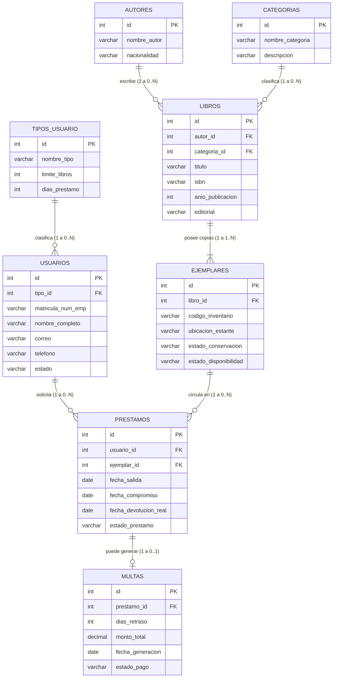

# Entregable 4: Diagrama Entidad-Relación (DER)

> **Materia:** Modelos de Bases de Datos  
> **Proyecto:** Sistema de Gestión Bibliotecaria  
> **Entregable:** 4 — Diagrama Entidad-Relación (DER) Conceptual y Lógico  
> **Fecha:** Noviembre 2026  

---

## Índice

1. [Notación Crow's Foot (Pata de Gallo) y Simbología de Cardinalidad](#1-notación-crows-foot-pata-de-gallo-y-simbología-de-cardinalidad)
2. [Evolución de Nombres: Simplificación de Claves (PK y FK)](#2-evolución-de-nombres-simplificación-de-claves-pk-y-fk)
   - [2.1 Justificación Técnica de PK Unificada como `id`](#21-justificación-técnica-de-pk-unificada-como-id)
   - [2.2 Estandarización de Claves Foráneas con Formato `[entidad]_id`](#22-estandarización-de-claves-foráneas-con-formato-entidad_id)
3. [Diagrama Entidad-Relación a Nivel Conceptual](#3-diagrama-entidad-relación-a-nivel-conceptual)
   - [3.1 Modelado Semántico de Alto Nivel](#31-modelado-semántico-de-alto-nivel)
   - [3.2 Descripción de Subsistemas de Negocio](#32-descripción-de-subsistemas-de-negocio)
4. [Diagrama Entidad-Relación a Nivel Lógico (Crow's Foot)](#4-diagrama-entidad-relación-a-nivel-lógico-crows-foot)
5. [Matriz Detallada de Relaciones y Cardinalidades](#5-matriz-detallada-de-relaciones-y-cardinalidades)
6. [Políticas de Integridad Referencial y Restricciones de Dominio](#6-políticas-de-integridad-referencial-y-restricciones-de-dominio)
   - [6.1 Acciones de Disparador Referencial (`ON DELETE` / `ON UPDATE`)](#61-acciones-de-disparador-referencial-on-delete--on-update)
   - [6.2 Restricciones de Unicidad y Dominio](#62-restricciones-de-unicidad-y-dominio)

---

## 1. Notación Crow's Foot (Pata de Gallo) y Simbología de Cardinalidad

Para la representación del modelo de base de datos se utiliza la notación **Crow's Foot (Pata de Gallo)**, estándar de la industria debido a su precisión gráfica y compacidad.

La notación define dos componentes esenciales en los extremos de cada línea de relación:
- **Participación / Cardinalidad Mínima (Símbolo interior más cercano a la línea):**
  - Círculo (`o`): Participación opcional (cardinalidad mínima `0`).
  - Barra transversal (`|`): Participación obligatoria (cardinalidad mínima `1`).
- **Multiplicidad / Cardinalidad Máxima (Símbolo exterior más cercano a la entidad):**
  - Barra transversal (`|`): Cardinalidad máxima `1` (uno y solo uno).
  - Pata de gallo con tres líneas abiertas (`{`): Cardinalidad máxima `N` (muchos).

Combinando ambos símbolos se obtienen los conectores exactos utilizados en este modelo:
- `||--o{` : Uno obligatorio a Cero o Muchos (1 a 0..N).
- `||--|{` : Uno obligatorio a Uno o Muchos (1 a 1..N).
- `||--o|` : Uno obligatorio a Cero o Uno (1 a 0..1).
- `||--||` : Uno obligatorio a Uno obligatorio (1 a 1).

---

## 2. Evolución de Nombres: Simplificación de Claves (PK y FK)

### 2.1 Justificación Técnica de PK Unificada como `id`

En el proceso de normalización analítica (Entregable 3), las claves primarias se nombraron provisionalmente con prefijos contextuales (`id_tipo`, `id_usuario`, `id_autor`, `id_libro`, etc.). 

Para el diseño del Diagrama Entidad-Relación y la subsiguiente implementación en software, se aplica la **regla de simplificación a `id`**, sustentada en sólidos principios de ingeniería de software y diseño relacional moderno (adoptado por frameworks industriales líderes como Ruby on Rails, Django, Laravel y estándares RESTful):

1. **Contexto Autosuficiente:** Dentro de la tabla `libros`, la columna `id` es intrínsecamente el identificador del libro; calificarlo como `libros.id_libro` incurre en una redundancia léxica (pleonasmo estructural).
2. **Polimorfismo e Interfaz Homogénea:** En el desarrollo de software y consultas genéricas (CRUD), todas las entidades comparten una propiedad identificadora uniforme (`$entidad->id` o `WHERE id = ?`), lo que reduce drásticamente la tasa de error por tipografía en controladores y modelos.
3. **Claridad Sintáctica:** Permite escribir consultas concisas y limpias al referirse a la entidad propietaria de los datos.

### 2.2 Estandarización de Claves Foráneas con Formato `[entidad]_id`

Cuando una clave primaria migra hacia otra tabla para materializar una relación, deja de ser el identificador del registro actual para convertirse en un enlace referencial externo. Por ello, todas las claves foráneas (`FK`) se estandarizan formalmente bajo el sufijo `_id`:

- En `usuarios`: `tipo_id` hace referencia a `tipos_usuario(id)`.
- En `libros`: `autor_id` hace referencia a `autores(id)`.
- En `libros`: `categoria_id` hace referencia a `categorias(id)`.
- En `ejemplares`: `libro_id` hace referencia a `libros(id)`.
- En `prestamos`: `usuario_id` hace referencia a `usuarios(id)`.
- En `prestamos`: `ejemplar_id` hace referencia a `ejemplares(id)`.
- En `multas`: `prestamo_id` hace referencia a `prestamos(id)`.

Esta convención genera una lectura natural e inmediata en las cláusulas de unión relacional:
```sql
SELECT * 
FROM libros l
JOIN autores a ON l.autor_id = a.id
JOIN ejemplares e ON e.libro_id = l.id;
```

---

## 3. Diagrama Entidad-Relación a Nivel Conceptual

### 3.1 Modelado Semántico de Alto Nivel

El nivel conceptual representa la visión holística del negocio bibliotecario universitario. Identifica las 8 entidades clave y los roles activos que desempeñan en los procesos institucionales.



### 3.2 Descripción de Subsistemas de Negocio

El modelo conceptual se compone armónicamente de tres grandes subsistemas interdependientes:

1. **Subsistema de Catálogo e Inventario Bibliográfico (`AUTORES`, `CATEGORIAS`, `LIBROS`, `EJEMPLARES`):**  
   Gestiona el patrimonio intelectual y físico de la institución. Separa la entidad intelectual (`LIBROS`) de su encarnación física en estantes (`EJEMPLARES`), garantizando que la pérdida, mantenimiento o adición de una copia tangible no altere la ficha bibliográfica del catálogo.
2. **Subsistema de Comunidad y Usuarios (`TIPOS_USUARIO`, `USUARIOS`):**  
   Administra el padrón de beneficiarios del servicio bibliotecario (alumnos, docentes e investigadores), vinculándolos con perfiles institucionales parametrizables que definen cuántos libros pueden retirar simultáneamente y por cuántos días continuos.
3. **Subsistema de Circulación, Préstamos y Control de Morosidad (`PRESTAMOS`, `MULTAS`):**  
   Registra el flujo transaccional en tiempo real: la entrega en mostrador de un ejemplar específico a un usuario identificado, el control de plazos de compromiso y el cómputo automático de sanciones financieras ante devoluciones extemporáneas.

---

## 4. Diagrama Entidad-Relación a Nivel Lógico (Crow's Foot)

A continuación se presenta el Diagrama Entidad-Relación Lógico en notación Crow's Foot, detallando las 8 entidades normalizadas, sus atributos, tipos de datos, claves primarias unificadas como `id` y claves foráneas bajo el estándar `[entidad]_id`:



---

## 5. Matriz Detallada de Relaciones y Cardinalidades

La siguiente matriz documenta formalmente la totalidad de las dependencias relacionales, indicando la clave primaria origen, la clave foránea receptora y las restricciones de multiplicidad en ambos extremos:

| # | Entidad Origen (1) | Clave PK | Cardinalidad Origen | Verbo de Relación | Cardinalidad Destino | Entidad Destino (N) | Clave Foránea (`FK`) | Regla Operativa y Comportamiento |
|---|---|---|---|---|---|---|---|---|
| **1** | `TIPOS_USUARIO` | `id` | `1` (Obligatoria) | Clasifica | `0..N` (Opcional) | `USUARIOS` | `tipo_id` | Un tipo de usuario puede tener cero o muchos prestatarios inscritos; todo usuario registrado debe poseer estrictamente un tipo asignado para heredar sus límites de préstamo. |
| **2** | `AUTORES` | `id` | `1` (Obligatoria) | Escribe | `0..N` (Opcional) | `LIBROS` | `autor_id` | Un autor registrado puede contar con cero o múltiples obras publicadas en el acervo; cada libro está atribuido formalmente a su autor principal dentro del alcance del MVP. |
| **3** | `CATEGORIAS` | `id` | `1` (Obligatoria) | Clasifica | `0..N` (Opcional) | `LIBROS` | `categoria_id` | Una categoría temática agrupa cero o muchas obras literarias; cada libro pertenece de forma excluyente a un área temática principal. |
| **4** | `LIBROS` | `id` | `1` (Obligatoria) | Se materializa en | `1..N` (Obligatoria) | `EJEMPLARES` | `libro_id` | Un libro en catálogo no puede existir operativamente sin copias físicas en existencia (al menos un ejemplar físico tangible inventariado); cada ejemplar físico ampara exactamente un único título intelectual. |
| **5** | `USUARIOS` | `id` | `1` (Obligatoria) | Solicita | `0..N` (Opcional) | `PRESTAMOS` | `usuario_id` | Un usuario universitario puede registrar un histórico de cero o múltiples solicitudes de préstamo; un registro transaccional de préstamo pertenece y es imputado a un único usuario responsable. |
| **6** | `EJEMPLARES` | `id` | `1` (Obligatoria) | Circula en | `0..N` (Opcional) | `PRESTAMOS` | `ejemplar_id` | Un ejemplar físico individual puede prestarse a lo largo de su vida útil cero o múltiples veces; cada préstamo transaccional involucra la custodia temporal de una única copia física identificada por marbete. |
| **7** | `PRESTAMOS` | `id` | `1` (Obligatoria) | Genera en mora | `0..1` (Opcional) | `MULTAS` | `prestamo_id` | Un préstamo cumplido en tiempo y forma no devenga sanción alguna (cardinalidad mínima `0`); si incurre en retraso, devenga como máximo una única multa global liquidable (cardinalidad máxima `1`). |

---

## 6. Políticas de Integridad Referencial y Restricciones de Dominio

### 6.1 Acciones de Disparador Referencial (`ON DELETE` / `ON UPDATE`)

La integridad referencial garantiza que la base de datos nunca albergue registros huérfanos o enlaces rotos. En el Diagrama Entidad-Relación Lógico, estas restricciones se formalizan como políticas declarativas:

```text
1. TIPOS_USUARIO -> USUARIOS
   - ON UPDATE CASCADE: Si se reorganiza el identificador del rol, se actualiza en cascada en los usuarios.
   - ON DELETE RESTRICT: Impide eliminar un tipo de usuario si todavía existen prestatarios asociados a él.

2. AUTORES -> LIBROS
   - ON UPDATE CASCADE: Modificaciones de clave migran en cascada.
   - ON DELETE RESTRICT: Prohíbe borrar un autor si existen obras en catálogo que dependen de su autoría.

3. CATEGORIAS -> LIBROS
   - ON UPDATE CASCADE: Sincronización automática de identificadores.
   - ON DELETE RESTRICT: Prohíbe borrar una categoría mientras existan libros catalogados bajo esa área.

4. LIBROS -> EJEMPLARES
   - ON UPDATE CASCADE: Modificaciones se reflejan inmediatamente en las copias físicas.
   - ON DELETE RESTRICT: Impide borrar un libro de catálogo mientras subsistan ejemplares físicos en inventario.

5. USUARIOS -> PRESTAMOS
   - ON UPDATE CASCADE: Sincronización en cascada de claves de usuario.
   - ON DELETE RESTRICT: Un usuario con historial de préstamos jamás puede ser eliminado físicamente de la base de datos (protección de auditoría transaccional e histórica).

6. EJEMPLARES -> PRESTAMOS
   - ON UPDATE CASCADE: Sincronización en cascada de claves de ejemplar.
   - ON DELETE RESTRICT: No se puede purgar un ejemplar físico si forma parte de un historial de préstamo registrado.

7. PRESTAMOS -> MULTAS
   - ON UPDATE CASCADE: Sincronización en cascada del identificador de préstamo.
   - ON DELETE RESTRICT: Protege la trazabilidad financiera; una multa vigente o pagada prohíbe el borrado de la transacción de préstamo que la originó.
```

### 6.2 Restricciones de Unicidad y Dominio

Para complementar el Diagrama Entidad-Relación y prevenir estados anómalos antes de la persistencia:

- **Restricciones de Unicidad (`UNIQUE`):**
  - `usuarios.matricula_num_emp`: Clave única para evitar suplantaciones de identidad.
  - `usuarios.correo`: Correo institucional unívoco por cuenta.
  - `libros.isbn`: Código ISBN unívoco para evitar duplicación de fichas catalográficas idénticas.
  - `ejemplares.codigo_inventario`: Marbete de código de barras único para cada volumen físico.
  - `multas.prestamo_id`: Restricción única para garantizar estrictamente la cardinalidad `1 a (0..1)`.
- **Restricciones de Integridad de Estado (`CHECK` / `ENUM` conceptual):**
  - `usuarios.estado`: Solo admite valores de dominio válidos (`Activo`, `Inactivo`, `Bloqueado`).
  - `ejemplares.estado_conservacion`: Restringido a (`Excelente`, `Bueno`, `Dañado`).
  - `ejemplares.estado_disponibilidad`: Restringido a (`Disponible`, `Prestado`, `En Reparacion`).
  - `prestamos.estado_prestamo`: Restringido a (`Activo`, `Devuelto`, `Vencido`).
  - `multas.estado_pago`: Restringido a (`Pendiente`, `Pagada`, `Condonada`).
  - `multas.monto_total >= 0.00`: Garantiza la no negatividad de importes adeudados.
