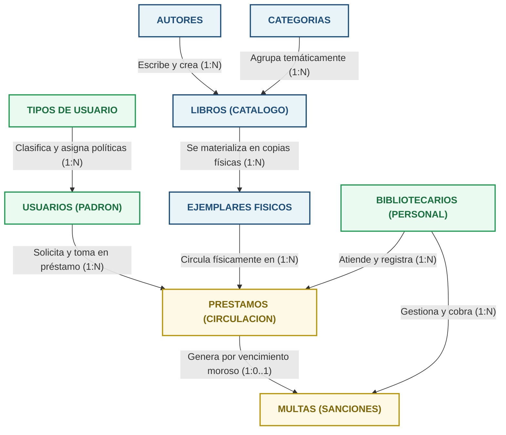
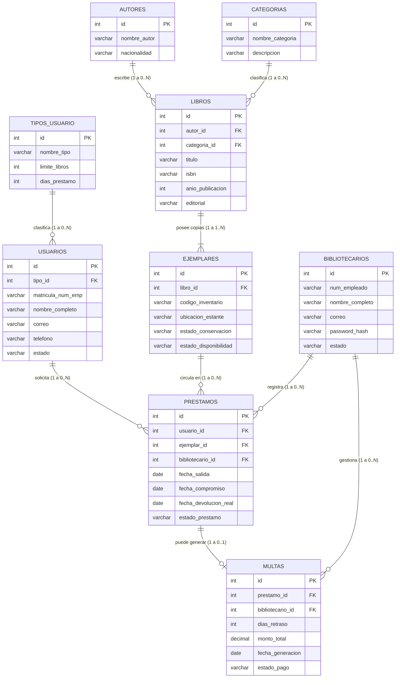

# Entregable 4: Diagrama Entidad-Relación (DER)

> **Materia:** Modelos de Bases de Datos  
> **Proyecto:** Sistema de Gestión Bibliotecaria  
> **Entregable:** 4 — Diagrama Entidad-Relación (DER) Conceptual y Lógico  
> **Fecha:** Noviembre 2026  

---

## Índice

1. [Evolución de Nombres: Simplificación de Claves (PK y FK)](#1-evolución-de-nombres-simplificación-de-claves-pk-y-fk)
2. [Diagrama Entidad-Relación a Nivel Conceptual](#2-diagrama-entidad-relación-a-nivel-conceptual)
   - [2.1 Modelado Semántico de Alto Nivel](#21-modelado-semántico-de-alto-nivel)
   - [2.2 Descripción de Subsistemas de Negocio](#22-descripción-de-subsistemas-de-negocio)
3. [Diagrama Entidad-Relación a Nivel Lógico (Crow's Foot)](#3-diagrama-entidad-relación-a-nivel-lógico-crows-foot)
4. [Matriz Detallada de Relaciones y Cardinalidades](#4-matriz-detallada-de-relaciones-y-cardinalidades)
5. [Políticas de Integridad Referencial y Restricciones de Dominio](#5-políticas-de-integridad-referencial-y-restricciones-de-dominio)
   - [5.1 Acciones de Disparador Referencial (`ON DELETE` / `ON UPDATE`)](#51-acciones-de-disparador-referencial-on-delete--on-update)
   - [5.2 Restricciones de Unicidad y Dominio](#52-restricciones-de-unicidad-y-dominio)

---

## 1. Evolución de Nombres: Simplificación de Claves (PK y FK)

En el Entregable 3 las claves se nombraron provisionalmente con prefijos (`id_libro`, `id_usuario`, etc.). Para el DER y la implementación en software, todas las claves primarias se simplifican a `id` (evitando redundancias como `libros.id_libro`) y todas las claves foráneas adoptan el formato `[entidad]_id` para distinguir claramente las referencias externas:

- **Ejemplo 1 (PK):** `libros.id_libro` → `libros.id`
- **Ejemplo 2 (FK):** `prestamos.id_usuario` → `prestamos.usuario_id` (referencia a `usuarios(id)`)

---

## 2. Diagrama Entidad-Relación a Nivel Conceptual

### 2.1 Modelado Semántico de Alto Nivel

El nivel conceptual representa la visión holística del negocio bibliotecario universitario. Identifica las 9 entidades clave y los roles activos que desempeñan en los procesos institucionales.



### 2.2 Descripción de Subsistemas de Negocio

El modelo conceptual se compone armónicamente de tres grandes subsistemas interdependientes:

1. **Subsistema de Catálogo e Inventario Bibliográfico (`AUTORES`, `CATEGORIAS`, `LIBROS`, `EJEMPLARES`):**  
   Gestiona el patrimonio intelectual y físico de la institución. Separa la entidad intelectual (`LIBROS`) de su encarnación física en estantes (`EJEMPLARES`), garantizando que la pérdida, mantenimiento o adición de una copia tangible no altere la ficha bibliográfica del catálogo.
2. **Subsistema de Comunidad, Usuarios y Personal (`TIPOS_USUARIO`, `USUARIOS`, `BIBLIOTECARIOS`):**  
   Administra tanto el padrón de beneficiarios del servicio bibliotecario (alumnos y docentes) vinculados con sus políticas de préstamo, como el registro independiente de los trabajadores de la biblioteca (`BIBLIOTECARIOS`) encargados de operar el sistema y autorizar movimientos en mostrador.
3. **Subsistema de Circulación, Préstamos y Control de Morosidad (`PRESTAMOS`, `MULTAS`):**  
   Registra el flujo transaccional en tiempo real: la entrega en mostrador de un ejemplar específico a un usuario identificado bajo la atención de un bibliotecario, el control de plazos de compromiso y el cómputo automático de sanciones financieras ante devoluciones extemporáneas.

---

## 3. Diagrama Entidad-Relación a Nivel Lógico

A continuación se presenta el Diagrama Entidad-Relación Lógico en notación Crow's Foot, detallando las 9 entidades normalizadas, sus atributos, tipos de datos, claves primarias unificadas como `id` y claves foráneas bajo el estándar `[entidad]_id`:



---

## 4. Matriz Detallada de Relaciones y Cardinalidades

La siguiente matriz documenta formalmente la totalidad de las dependencias relacionales, indicando la clave primaria origen, la clave foránea receptora y las restricciones de multiplicidad en ambos extremos:

| # | Entidad Origen (1) | Clave PK | Cardinalidad Origen | Verbo de Relación | Cardinalidad Destino | Entidad Destino (N) | Clave Foránea (`FK`) | Regla Operativa y Comportamiento |
|---|---|---|---|---|---|---|---|---|
| **1** | `TIPOS_USUARIO` | `id` | `1` (Obligatoria) | Clasifica | `0..N` (Opcional) | `USUARIOS` | `tipo_id` | Un tipo de usuario puede tener cero o muchos prestatarios inscritos; todo usuario registrado debe poseer estrictamente un tipo asignado para heredar sus límites de préstamo. |
| **2** | `AUTORES` | `id` | `1` (Obligatoria) | Escribe | `0..N` (Opcional) | `LIBROS` | `autor_id` | Un autor registrado puede contar con cero o múltiples obras publicadas en el acervo; cada libro está atribuido formalmente a su autor principal dentro del alcance del MVP. |
| **3** | `CATEGORIAS` | `id` | `1` (Obligatoria) | Clasifica | `0..N` (Opcional) | `LIBROS` | `categoria_id` | Una categoría temática agrupa cero o muchas obras literarias; cada libro pertenece de forma excluyente a un área temática principal. |
| **4** | `LIBROS` | `id` | `1` (Obligatoria) | Se materializa en | `1..N` (Obligatoria) | `EJEMPLARES` | `libro_id` | Un libro en catálogo no puede existir operativamente sin copias físicas en existencia (al menos un ejemplar físico tangible inventariado); cada ejemplar físico ampara exactamente un único título intelectual. |
| **5** | `USUARIOS` | `id` | `1` (Obligatoria) | Solicita | `0..N` (Opcional) | `PRESTAMOS` | `usuario_id` | Un usuario universitario puede registrar un histórico de cero o múltiples solicitudes de préstamo; un registro transaccional de préstamo pertenece y es imputado a un único usuario responsable. |
| **6** | `EJEMPLARES` | `id` | `1` (Obligatoria) | Circula en | `0..N` (Opcional) | `PRESTAMOS` | `ejemplar_id` | Un ejemplar físico individual puede prestarse a lo largo de su vida útil cero o múltiples veces; cada préstamo transaccional involucra la custodia temporal de una única copia física identificada por marbete. |
| **7** | `PRESTAMOS` | `id` | `1` (Obligatoria) | Genera en mora | `0..1` (Opcional) | `MULTAS` | `prestamo_id` | Un préstamo cumplido en tiempo y forma no devenga sanción alguna (cardinalidad mínima `0`); si incurre en retraso, devenga como máximo una única multa global liquidable (cardinalidad máxima `1`). |
| **8** | `BIBLIOTECARIOS` | `id` | `1` (Obligatoria) | Registra | `0..N` (Opcional) | `PRESTAMOS` | `bibliotecario_id` | Un bibliotecario puede autorizar cero o muchos préstamos; cada préstamo registrado en mostrador debe asociarse obligatoriamente al bibliotecario responsable. |
| **9** | `BIBLIOTECARIOS` | `id` | `1` (Obligatoria) | Gestiona / Cobra | `0..N` (Opcional) | `MULTAS` | `bibliotecario_id` | Un bibliotecario puede gestionar o cobrar cero o múltiples multas; la clave foránea en `MULTAS` admite `NULL` si la sanción se genera automáticamente antes de su cobro en caja. |

---

## 5. Políticas de Integridad Referencial y Restricciones de Dominio

### 5.1 Acciones de Disparador Referencial (`ON DELETE` / `ON UPDATE`)

La integridad referencial garantiza que la base de datos nunca albergue registros huérfanos o enlaces rotos. En el Diagrama Entidad-Relación Lógico, estas restricciones se formalizan como políticas declarativas:

```text
1. TIPOS_USUARIO -> USUARIOS
   - ON UPDATE CASCADE: Si se reorganiza el identificador del rol, se actualiza en cascada en los usuarios.
   - ON DELETE RESTRICT: Impide eliminar un tipo de usuario si todavía existen prestatarios asociados a él.

2. AUTORES -> LIBROS
   - ON UPDATE CASCADE: Modificaciones de clave migran en cascada.
   - ON DELETE RESTRICT: Prohíbe borrar un autor si existen obras en catálogo que dependen de su autoría.

3. CATEGORIAS -> LIBROS
   - ON UPDATE CASCADE: Sincronización automática de identificadores.
   - ON DELETE RESTRICT: Prohíbe borrar una categoría mientras existan libros catalogados bajo esa área.

4. LIBROS -> EJEMPLARES
   - ON UPDATE CASCADE: Modificaciones se reflejan inmediatamente en las copias físicas.
   - ON DELETE RESTRICT: Impide borrar un libro de catálogo mientras subsistan ejemplares físicos en inventario.

5. USUARIOS -> PRESTAMOS
   - ON UPDATE CASCADE: Sincronización en cascada de claves de usuario.
   - ON DELETE RESTRICT: Un usuario con historial de préstamos jamás puede ser eliminado físicamente de la base de datos (protección de auditoría transaccional e histórica).

6. EJEMPLARES -> PRESTAMOS
   - ON UPDATE CASCADE: Sincronización en cascada de claves de ejemplar.
   - ON DELETE RESTRICT: No se puede purgar un ejemplar físico si forma parte de un historial de préstamo registrado.

7. PRESTAMOS -> MULTAS
   - ON UPDATE CASCADE: Sincronización en cascada del identificador de préstamo.
   - ON DELETE RESTRICT: Protege la trazabilidad financiera; una multa vigente o pagada prohíbe el borrado de la transacción de préstamo que la originó.

8. BIBLIOTECARIOS -> PRESTAMOS
   - ON UPDATE CASCADE: Sincronización en cascada del identificador del bibliotecario.
   - ON DELETE RESTRICT: Impide eliminar físicamente a un bibliotecario que haya registrado préstamos históricos.

9. BIBLIOTECARIOS -> MULTAS
   - ON UPDATE CASCADE: Sincronización en cascada del identificador del bibliotecario.
   - ON DELETE RESTRICT: Impide eliminar físicamente a un bibliotecario que haya gestionado o cobrado multas.
```

### 5.2 Restricciones de Unicidad y Dominio

Para complementar el Diagrama Entidad-Relación y prevenir estados anómalos antes de la persistencia:

- **Restricciones de Unicidad (`UNIQUE`):**
  - `usuarios.matricula_num_emp`: Clave única para evitar suplantaciones de identidad.
  - `usuarios.correo`: Correo institucional unívoco por cuenta.
  - `bibliotecarios.num_empleado`: Número de empleado institucional único por trabajador.
  - `bibliotecarios.correo`: Correo institucional único para autenticación.
  - `libros.isbn`: Código ISBN unívoco para evitar duplicación de fichas catalográficas idénticas.
  - `ejemplares.codigo_inventario`: Marbete de código de barras único para cada volumen físico.
  - `multas.prestamo_id`: Restricción única para garantizar estrictamente la cardinalidad `1 a (0..1)`.
- **Restricciones de Integridad de Estado (`CHECK` / `ENUM` conceptual):**
  - `usuarios.estado`: Solo admite valores de dominio válidos (`Activo`, `Inactivo`, `Bloqueado`).
  - `bibliotecarios.estado`: Solo admite valores de dominio válidos (`Activo`, `Inactivo`).
  - `ejemplares.estado_conservacion`: Restringido a (`Excelente`, `Bueno`, `Dañado`).
  - `ejemplares.estado_disponibilidad`: Restringido a (`Disponible`, `Prestado`, `En Reparacion`).
  - `prestamos.estado_prestamo`: Restringido a (`Activo`, `Devuelto`, `Vencido`).
  - `multas.estado_pago`: Restringido a (`Pendiente`, `Pagada`, `Condonada`).
  - `multas.monto_total >= 0.00`: Garantiza la no negatividad de importes adeudados.
