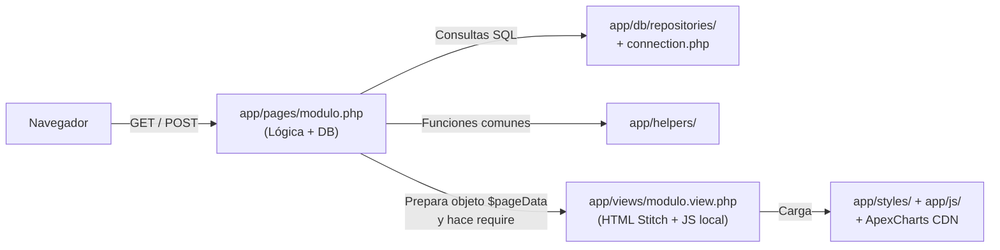

# SPEC 07 — Arquitectura Simple y Estructura Base del Proyecto

> **Status:** Implemented  
> **Depends on:** SPEC 06  
> **Date:** 2026-11-23  
> **Objective:** Definir una arquitectura PHP simple y clara para el equipo (máximo 2 archivos por pantalla mediante `pages/` + `views/` con objeto de datos) y crear la estructura base de carpetas, `index.php`, la conexión PDO, `schema.sql` con las 9 tablas más el bibliotecario inicial y un ejemplo mínimo de login.

---

## 1. Contexto y Principios Rectores

El Sistema de Gestión Bibliotecaria opera sobre **WampServer** (Apache + MySQL/MariaDB + PHP) con un esquema relacional de **9 tablas en 3FN** (`SPEC 06`) y el sistema de diseño definido en `DESIGN.md` / Google Stitch.

Dado que el equipo de desarrollo está iniciando en programación, esta arquitectura prioriza la **simplicidad, claridad y cero magia**, evitando frameworks, Composer, namespaces complejos, `.htaccess` o patrones avanzados:

- **Máximo 2 archivos por pantalla:** Cada vista se divide en un archivo de lógica (`app/pages/<modulo>.php`) y un archivo de presentación (`app/views/<modulo>.view.php`). El archivo de lógica prepara un objeto `$pageData` con todo lo necesario y carga la vista con `require`.
- **Formularios PHP clásicos (POST + redirección):** Las operaciones CRUD se procesan directamente con formularios HTML hacia el mismo archivo en `app/pages/`, evitando APIs JSON y `fetch` innecesarios.
- **JavaScript acotado y práctico:** Cada vista puede incluir su `<script>` pequeño para interacciones locales (modales, confirmaciones o gráficas con **ApexCharts vía CDN**). Las funciones JS reutilizables se guardan en `app/js/`.
- **PHP puro sin dependencias externas:** Conexión PDO centralizada en `app/db/connection.php` usando *Prepared Statements* y funciones simples en `app/db/repositories/` y `app/helpers/`.

---

## 2. Alcance

**In:**

- Definición formal de la arquitectura y estructura de carpetas del proyecto (`index.php` en raíz + código en `app/`).
- Actualización de `.gitignore` para excluir archivos subidos en `app/up/*` (conservando `app/up/.gitkeep`).
- Creación de la estructura de carpetas en `app/`:
  - `app/db/` y `app/db/repositories/`
  - `app/pages/`
  - `app/views/` y `app/views/partials/`
  - `app/styles/`
  - `app/js/`
  - `app/helpers/`
  - `app/up/`
- Creación de los archivos iniciales de base de datos en `app/db/`:
  - `app/db/connection.php` (función reutilizable `getDbConnection(): PDO` con credenciales locales WampServer integradas: `127.0.0.1:3306`, `biblioteca_db`, `root` / `root`, `utf8mb4`, `ERRMODE_EXCEPTION`, `FETCH_ASSOC`, `EMULATE_PREPARES => false`, además de la constante `FINE_RATE_PER_DAY = 15.00`).
  - `app/db/schema.sql` (`CREATE DATABASE IF NOT EXISTS biblioteca_db`, `USE biblioteca_db`, las 9 tablas exactas de `docs/05-diccionario-de-datos.md` y el `INSERT IGNORE` del bibliotecario inicial `EMP-001` / `admin@biblioteca.local` con hash bcrypt de `Admin123!`).
  - `app/db/seeder.sql` (plantilla vacía comentada lista para poblar datos de prueba en specs futuros).
- Creación de `index.php` en la raíz redirigiendo a `app/pages/login.php`.
- Creación del ejemplo mínimo del patrón de 2 archivos: `app/pages/login.php` (arma el objeto `$pageData` y carga la vista) + `app/views/login.view.php` (recibe `$pageData` y renderiza un formulario placeholder limpio).
- Actualización de la sección de arquitectura en `ABOUT.md` para reflejar esta estructura simplificada (conservando `arq-proposal.md` en el repositorio).

**Out of scope:**

- Implementación real de autenticación, sesiones de usuario, validadores o CRUD de los módulos del sistema (se desarrollarán en specs posteriores).
- Integración visual completa de las pantallas de Google Stitch, archivos CSS definitivos en `app/styles/` o gráficas de ApexCharts.
- Ejecución automática de `schema.sql` contra el servidor MySQL local (la importación se realizará manualmente en phpMyAdmin).
- Eliminación o modificación de `arq-proposal.md` y de los documentos académicos `docs/01` a `docs/05`.

---

## 3. Estructura de Directorios y Modelo de Datos

### 3.1 Árbol de directorios

```text
ProyectoFinal/
├── index.php                        # Punto de entrada en raíz: redirige a app/pages/login.php
├── app/
│   ├── db/
│   │   ├── connection.php           # Función getDbConnection(): PDO con credenciales locales y constantes
│   │   ├── schema.sql               # DDL de biblioteca_db (9 tablas en 3FN) + bibliotecario inicial
│   │   ├── seeder.sql               # Plantilla vacía para datos de prueba futuros
│   │   └── repositories/            # Consultas SQL agrupadas por entidad (ej. books_repo.php)
│   │       └── .gitkeep
│   ├── pages/                       # Lógica por pantalla: procesa POST/GET, consulta db/ y arma $pageData
│   │   └── login.php                # Ejemplo mínimo del patrón de 2 archivos
│   ├── views/                       # Presentación por pantalla: HTML (Stitch) + <script> local usando $pageData
│   │   ├── partials/                # Fragmentos reutilizables (header.php, sidebar.php, topbar.php)
│   │   │   └── .gitkeep
│   │   └── login.view.php           # Vista mínima de ejemplo que consume $pageData
│   ├── styles/                      # CSS puro modular basado en DESIGN.md / Stitch
│   │   └── .gitkeep
│   ├── js/                          # Funciones JS reutilizables y configuración común de ApexCharts
│   │   └── .gitkeep
│   ├── helpers/                     # Funciones PHP reutilizables por módulo (auth, validación, formato)
│   │   └── .gitkeep
│   └── up/                          # Archivos subidos por usuarios (contenido ignorado en .gitignore)
│       └── .gitkeep
├── docs/                            # Documentación académica existente (sin cambios)
├── specs/                           # Especificaciones del proyecto
├── scripts/                         # Scripts utilitarios existentes
├── ABOUT.md                         # Actualizado con esta arquitectura
├── DESIGN.md                        # Sistema de diseño de Stitch
└── arq-proposal.md                  # Conservado como referencia inicial
```

### 3.2 Flujo del patrón de 2 archivos por pantalla



Convención obligatoria por pantalla:
1. `app/pages/<modulo>.php`: inicia/verifica sesión cuando corresponda, procesa `$_POST` / `$_GET`, llama funciones de `app/db/repositories/` y `app/helpers/`, construye un único objeto `$pageData = (object) [...]` y termina con `require __DIR__ . '/../views/<modulo>.view.php';`.
2. `app/views/<modulo>.view.php`: declara al inicio mediante un bloque PHPDoc (`@var object{...} $pageData`) la estructura exacta de datos y acciones/métodos que recibe la vista, nunca ejecuta SQL ni modifica estado; solo renderiza HTML (escapando texto con `htmlspecialchars`), incluye parciales de `app/views/partials/` y contiene el `<script>` específico de esa pantalla si lo necesita.

### 3.3 Base de datos (`biblioteca_db`) y bibliotecario inicial

`app/db/schema.sql` crea la base de datos `biblioteca_db` (`utf8mb4` / `utf8mb4_unicode_ci`) con las **9 tablas** exactas de `docs/05-diccionario-de-datos.md`:
`tipos_usuario`, `usuarios`, `bibliotecarios`, `autores`, `categorias`, `libros`, `ejemplares`, `prestamos`, `multas`.

Al final de `app/db/schema.sql`, se inserta únicamente el bibliotecario administrador inicial de forma idempotente (`INSERT IGNORE INTO bibliotecarios`):

| Campo | Valor |
|---|---|
| `num_empleado` | `'EMP-001'` |
| `nombre_completo` | `'Administrador de Biblioteca'` |
| `correo` | `'admin@biblioteca.local'` |
| `password_hash` | Hash bcrypt (`$2y$10$...`) válido para `Admin123!` |
| `estado` | `'Activo'` |

---

## 4. Plan de implementación

1. **Actualizar `.gitignore`:**
   - Agregar `app/up/*` y `!app/up/.gitkeep` para excluir archivos subidos sin perder la carpeta `app/up/`.
2. **Crear estructura de carpetas base en `app/`:**
   - Crear `app/db/repositories/.gitkeep`, `app/views/partials/.gitkeep`, `app/styles/.gitkeep`, `app/js/.gitkeep`, `app/helpers/.gitkeep` y `app/up/.gitkeep`.
3. **Crear conexión PDO en `app/db/connection.php`:**
   - Definir la constante `FINE_RATE_PER_DAY = 15.00` y la función `getDbConnection(): PDO` con los parámetros locales de WampServer integrados (`127.0.0.1`, `3306`, `biblioteca_db`, `utf8mb4`, `root`, `root`), instancia estática reutilizable, `ERRMODE_EXCEPTION`, `FETCH_ASSOC` y `EMULATE_PREPARES => false`.
4. **Crear scripts SQL en `app/db/`:**
   - Crear `app/db/schema.sql` con `CREATE DATABASE IF NOT EXISTS biblioteca_db`, `USE biblioteca_db`, las 9 sentencias `CREATE TABLE IF NOT EXISTS` fieles a `docs/05-diccionario-de-datos.md` y el `INSERT IGNORE` del bibliotecario inicial `EMP-001` con hash bcrypt válido de `Admin123!`.
   - Crear `app/db/seeder.sql` como plantilla comentada vacía para futuros datos de prueba.
5. **Crear punto de entrada y ejemplo del patrón de 2 archivos:**
   - Crear `index.php` en la raíz que redirija con `header('Location: app/pages/login.php')` y `exit;`.
   - Crear `app/pages/login.php` que construya `$pageData = (object) ['title' => ..., 'subtitle' => ..., 'error' => null]` y haga `require __DIR__ . '/../views/login.view.php';`.
   - Crear `app/views/login.view.php` mostrando un formulario mínimo que consume `$pageData` usando `htmlspecialchars`.
6. **Actualizar documentación del proyecto:**
   - Actualizar la sección 3 de `ABOUT.md` para documentar esta arquitectura simple (`app/pages/` + `app/views/`, `app/db/`, `app/helpers/`, `app/styles/`, `app/js/`, `app/up/`, ApexCharts vía CDN) y conservar `arq-proposal.md`.
7. **Verificación final:**
   - Ejecutar comprobación de sintaxis PHP (`php -l`) sobre `index.php`, `app/db/connection.php`, `app/pages/login.php` y `app/views/login.view.php`.
   - Verificar que el hash bcrypt en `app/db/schema.sql` valida contra `Admin123!`.
   - Verificar con `git status` que `app/up/` conserva `.gitkeep` y `arq-proposal.md` sigue intacto.

---

## 5. Criterios de aceptación

- [x] `.gitignore` ignora los archivos dentro de `app/up/` (excepto `.gitkeep`), confirmado con `git status`.
- [x] Existen las carpetas `app/db/repositories/`, `app/pages/`, `app/views/partials/`, `app/styles/`, `app/js/`, `app/helpers/` y `app/up/`.
- [x] Existe `app/db/connection.php` con `getDbConnection(): PDO`, credenciales locales integradas (`127.0.0.1:3306`, `biblioteca_db`, `root`/`root`) y constante `FINE_RATE_PER_DAY = 15.00`.
- [x] `app/db/schema.sql` incluye `CREATE DATABASE IF NOT EXISTS biblioteca_db`, `USE biblioteca_db`, las 9 tablas exactas de `docs/05-diccionario-de-datos.md` y únicamente el `INSERT IGNORE` del bibliotecario inicial (`EMP-001`, `admin@biblioteca.local`, hash bcrypt válido de `Admin123!`).
- [x] `app/db/seeder.sql` existe como plantilla vacía comentada sin insertar registros todavía.
- [x] `index.php` en la raíz redirige a `app/pages/login.php`, y el par `app/pages/login.php` + `app/views/login.view.php` demuestra el paso de datos mediante un objeto `$pageData`.
- [x] `ABOUT.md` refleja la nueva arquitectura simplificada y `arq-proposal.md` se conserva sin eliminar.
- [x] Todos los archivos `.php` creados pasan `php -l` sin errores de sintaxis.

---

## 6. Decisiones tomadas y descartadas

- **Patrón de 2 archivos (`app/pages/` + `app/views/` con `$pageData`) vs. MVVM/SPA:** Se eligió separar lógica y HTML en 2 archivos por pantalla con formularios PHP clásicos (POST + redirección) para que el equipo sin experiencia previa pueda entender y mantener cada módulo sin aprender APIs JSON, `fetch` ni ES Modules.
- **Carpeta `app/db/` unificada:** Se concentró `connection.php`, `config.php`, `schema.sql`, `seeder.sql` y `repositories/` dentro de `app/db/` siguiendo `arq-proposal.md`, evitando una carpeta `config/` adicional.
- **Carpetas de soporte (`app/js/` y `app/views/partials/`):** Se añadieron únicamente estas dos carpetas sobre `arq-proposal.md` para evitar duplicar el menú/header en cada vista y centralizar funciones JS reutilizables junto con ApexCharts vía CDN.
- **Bibliotecario inicial dentro de `schema.sql`:** Se coloca el `INSERT IGNORE` de `EMP-001` al final de `schema.sql` para que al importar el esquema en phpMyAdmin la BD quede lista con un administrador operativo y las demás 8 tablas vacías.
- **Conservar `arq-proposal.md`:** Se mantiene en el repositorio como referencia histórica de las necesidades del equipo mientras `ABOUT.md` se actualiza con la arquitectura aprobada.

---

## 7. Riesgos identificados

- **Lógica filtrada en las vistas:** Sin disciplina, es fácil agregar consultas SQL dentro de `app/views/*.view.php`. Regla del equipo: todo acceso a `app/db/` ocurre exclusivamente en `app/pages/*.php` y pasa a la vista dentro de `$pageData`.
- **Seguridad en `app/up/`:** Cuando se implemente subida de archivos en specs posteriores, deberá validarse extensión, tipo MIME y tamaño en PHP (y evitar ejecución de `.php` dentro de `app/up/`).
- **Credencial de desarrollo (`Admin123!`):** Válida únicamente para entorno local en WampServer; debe cambiarse si el sistema se despliega fuera de local.
